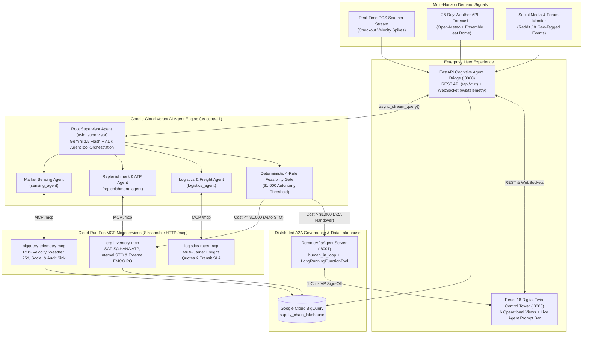

# NexusTwin AI — Autonomous Multi-Echelon Supply Chain Digital Twin

> **Closing the Retail Shelf-to-Factory Visibility Gap with Google Cloud Vertex AI Agent Engine, Google ADK, Cloud Run Model Context Protocol (FastMCP), Agent-to-Agent (A2A) Governance, and BigQuery Lakehouse.**

---

## 1. The Idea

**NexusTwin AI** is an **Autonomous Cognitive Supply Chain Digital Twin** built on Google Cloud. It continuously senses real-time consumer demand at retail shelves—combining **live POS checkout scanner streams**, **25-day long-range weather ensemble forecasts**, and **geo-tagged social media/forum event signals**—and autonomously orchestrates inventory rebalancing across **Retail Stores**, **Regional Distribution Centers (DCs)**, and **Upstream FMCG Manufacturing Plants** before a stockout ever occurs.

Unlike black-box AI assistants, NexusTwin AI pairs **Google ADK multi-agent reasoning** on **Vertex AI Agent Engine** with a **Deterministic 4-Rule Supply Chain Feasibility Gate** and **Google ADK Agent-to-Agent (`RemoteA2aAgent`) Human-in-the-Loop governance**. Routine internal transfers ($\le \$1,000$ freight) execute autonomously in seconds in SAP S/4HANA, while high-value external factory Purchase Orders ($> \$1,000$) are seamlessly handed over via the A2A protocol to a VP Approvals Queue with full financial ROI and root-cause transparency.

---

## 2. Problem Statement

Global retail and FMCG supply chains lose **over \$1 Trillion annually** to out-of-stock (OOS) events and reactionary expedited freight due to four structural breakdowns:

1. **The 48-to-72 Hour Bullwhip Blindspot:**
   Traditional ERP nightly batch jobs only detect a store stockout *after* shelves are empty. By the time a store reorders from a Regional DC—or a DC realizes it is short and raises a Purchase Order to the FMCG factory—the localized demand surge (a weekend heatwave or stadium marathon) is already over, resulting in lost sales followed by excess inventory.
2. **Siloed Demand Signals (POS vs. Weather vs. Social Buzz):**
   Supply planners look at historical POS averages in one system, weather reports in another, and have zero visibility into viral local community events (Reddit/X marathons, festivals, fitness expos) happening 1–2 miles from a store.
3. **Uncoordinated Multi-Echelon Escalation (DC vs. Factory):**
   When a store surges, legacy systems blindly request stock from the primary serving DC without checking real-time **Available-to-Promise (ATP)** surplus above safety buffers, nor do they dynamically escalate to an upstream **FMCG Manufacturing Plant (EDI 850 PO)** when a local DC is depleted.
4. **Lack of Financial Guardrails for Autonomous AI:**
   Enterprises cannot let LLMs freely book \$4,200 air cargo or \$17,000 factory purchase orders without deterministic margin checks, SLA validation, and auditable Human-in-the-Loop (HITL) sign-off.

---

## 3. Our Solution: How NexusTwin AI Solves It

NexusTwin AI transforms reactive supply chain management into a **proactive, self-healing 3-tier network** (`1 Upstream FMCG Bottling Plant` $\leftrightarrow$ `3 Regional DCs` $\leftrightarrow$ `6 Retail Stores` in the Texas Triangle):

| Challenge | NexusTwin AI Solution | Google Cloud & Open Protocols Used |
| :--- | :--- | :--- |
| **Multi-Horizon Demand Sensing** | Correlates real-time POS velocity spikes (`t=0`), viral Reddit/X local events (`t+12h`), and 25-day extreme heatwave predictions (`t+25d`). | **BigQuery Lakehouse**, **Open-Meteo Weather API**, **`bigquery_telemetry_mcp`** on Cloud Run |
| **Multi-Echelon ATP & Factory Escalation** | Checks serving DC Available-to-Promise (`On-Hand - Safety Buffer`). If the DC has surplus, dispatches an internal **SAP Stock Transfer Order (`STO_FROM_DC`)**. If the DC is short, automatically escalates to the **FMCG Bottling Plant** via an external **Purchase Order (`PO_TO_FMCG`)**. | **Vertex AI Agent Engine**, **Google ADK**, **`erp_inventory_mcp`** on Cloud Run |
| **Dynamic Carrier & Freight Optimization** | Compares dedicated ground, economy pre-positioning, and direct cold-chain carriers to ensure freight arrives before stockout runway expiration while protecting product gross margin. | **`logistics_rates_mcp`** (FastMCP Streamable HTTP on Cloud Run) |
| **Deterministic Governance & A2A HITL** | Enforces a **4-Rule Feasibility Gate** (ATP, SLA Runway, Positive ROI Margin, and \$1,000 Autonomy Cap). Orders $\le \$1,000$ auto-execute; orders $> \$1,000$ pause via `LongRunningFunctionTool` over the **A2A Protocol** for 1-click VP approval. | **ADK `RemoteA2aAgent`**, **`to_a2a()` Starlette Server**, **4-Rule Gate** |
| **Immutable Operational Auditability** | Every sensor reading, agent tool call, gate evaluation, and SAP/EDI order ID is recorded to a BigQuery Audit Ledger and streamed live to a 6-tab React Control Tower. | **BigQuery (`supply_chain_lakehouse.audit_ledger`)**, **FastAPI WebSockets**, **React 18** |

---

## 4. System Architecture



---

## 5. The 4 Live Enterprise Scenarios (End-to-End Walkthrough)

All 4 scenarios focus on our Hero Product **`SKU-4089-HYDRATE` (HydroBoost Electrolyte 12-Pack, \$14.99 retail, \$6.20 gross margin)** across a 3-tier Texas network (**1 FMCG Bottling Plant in Waco**, **3 Regional DCs in Austin, Houston, and San Antonio**, and **6 Retail Stores**):

### Scenario 1 — Shop 1 (`STORE-DAL-04`, Dallas): Fast POS Surge $\rightarrow$ Autonomous Internal DC STO
* **Trigger:** Checkout scanner velocity spikes to **215 units/hr** (+348% over the 48 u/hr baseline) during a 98.2°F heatwave, leaving only 180 units on the shelf (~50 minutes of stockout runway).
* **Swarm Action:**
  1. `sensing_agent` validates the POS anomaly via `bigquery-telemetry-mcp`.
  2. `replenishment_agent` queries `erp-inventory-mcp` for the serving Austin DC (`DC-ATX-02`), confirming **3,600 ATP surplus units** above its 1,200-unit safety buffer.
  3. `logistics_agent` quotes dedicated ground transfer via `logistics-rates-mcp` at **\$750.00** for 1,500 units.
* **Feasibility Gate Verdict:** **AUTONOMOUSLY APPROVED** (Freight \$750 $\le$ \$1,000 cap; ROI protegé +\$8,550 net value). Dispatches internal SAP Stock Transfer Order (`STO-SAP-...`).

### Scenario 2 — Shop 2 (`STORE-HOU-05`, Houston): POS Surge + DC Shortage $\rightarrow$ External FMCG PO & A2A HITL
* **Trigger:** Checkout velocity at Houston Galleria spikes to **230 units/hr**, requiring **1,800 units**.
* **Swarm Action:**
  1. `replenishment_agent` checks the serving Houston DC (`DC-HOU-01`) via `erp-inventory-mcp` and discovers **only 180 ATP surplus units** (1,680 on-hand minus 1,500 safety buffer)—**insufficient to fulfill the 1,800-unit demand!**
  2. Rather than breaching DC safety stock, the swarm **escalates upstream to Tier 1: HydroBoost FMCG Bottling Plant (`FMCG-PLANT-TX01`, 45,000 ATP)** via an External Purchase Order (`PO_TO_FMCG`).
  3. `logistics_agent` quotes direct cold-chain freight at **\$1,850.00** (plus **\$15,822.00** wholesale merchandise @ \$8.79/unit = **\$17,672.00 total commitment**).
* **Feasibility Gate Verdict:** **REFERRED TO HUMAN (`RemoteA2aAgent`)** because freight (\$1,850) and total commitment (\$17,672) exceed the \$1,000 autonomy limit. The supervisor delegates to `approval_agent` over the A2A protocol, surfacing an interactive approval card in **Tab 5 (Approvals Queue)** for 1-click VP sign-off.

### Scenario 3 — Shop 3 (`STORE-PLANO-07`, Plano): 25-Day Weather API Heat Dome Prediction
* **Trigger:** Current POS velocity at Plano is completely normal today (42 u/hr @ 79.4°F). However, `sensing_agent` queries `get_long_range_weather_forecast` (connected to the live **Open-Meteo API + 30-Day Ensemble**) and detects a **104.2°F Extreme Heat Dome arriving in T+25 Days**.
* **Swarm Action:**
  1. Predicts a +220% beverage demand surge (1,500 extra units needed) 25 days before it hits the checkout scanners.
  2. Books **Scheduled Economy Ground Pre-Positioning** from `DC-ATX-02` at just **\$480.00** (saving >85% compared to \$3,500+ last-minute emergency air freight).
* **Feasibility Gate Verdict:** **AUTONOMOUSLY APPROVED** (\$480 $\le$ \$1,000).

### Scenario 4 — Shop 4 (`STORE-ARL-11`, Arlington): Viral Social Media & Forum Event Spike
* **Trigger:** `sensing_agent` monitors geo-tagged public forums (**Reddit `r/arlington` & X**) via `monitor_social_media_and_forums` and detects a viral buzz score of **94.5/100** for the *Arlington Stadium Charity Marathon (18,500 registered runners)* located 1.2 miles from Shop 4.
* **Swarm Action:**
  1. Stages **1,200 units** from the San Antonio Regional DC (`DC-SAT-03`, 1,600 ATP surplus) via Alamo Regional Express at **\$680.00** freight.
* **Feasibility Gate Verdict:** **AUTONOMOUSLY APPROVED** (\$680 $\le$ \$1,000).

---

## 6. Deterministic 4-Rule Supply Chain Feasibility Gate

Every replenishment proposal generated by the ADK swarm is validated by deterministic Python guardrails (`agents/src/nexustwin_agents/gate.py`) before any ERP transaction occurs:

1. **Rule 1 — `INVENTORY_ATP_FEASIBLE`:** Verifies that the selected donor DC (or FMCG Plant) has `ATP Surplus >= Requested Units` without dipping into local safety stock buffers.
2. **Rule 2 — `SLA_BEFORE_STOCKOUT`:** Verifies that carrier transit time + warehouse handling arrives within the store's stockout runway window (or 25-day pre-positioning window).
3. **Rule 3 — `ROI_MARGIN_POSITIVE`:** Verifies that protected gross margin (`Units * $6.20`) strictly exceeds the quoted freight expense.
4. **Rule 4 — `AUTONOMY_OR_HITL`:** Enforces the **\$1,000.00** financial autonomy threshold:
   - **$\le \$1,000.00$:** Automatically dispatches the SAP Stock Transfer Order (`STO-SAP-...`).
   - **$> \$1,000.00$:** Triggers `RemoteA2aAgent` handover (`approval_agent`) and waits for human executive authorization.

---

## 7. Repository Structure

```text
Prototype/src/
├── shared/                       # Shared domain schemas, Texas topology & BigQuery Lakehouse manager
│   ├── schemas.py                # Pydantic v2 contracts (Signals, Proposals, Gate, Manifests)
│   ├── topology.py               # 1 FMCG Plant, 3 Regional DCs, 6 Retail Stores, SKU catalog
│   └── bq_lakehouse.py           # Write-through BigQuery Lakehouse & live Open-Meteo 25d API
├── mcp-servers/                  # Cloud Run FastMCP Microservices (Streamable HTTP /mcp)
│   ├── erp_inventory_mcp/        # SAP S/4HANA Inventory, ATP check, STO & FMCG PO execution
│   ├── logistics_rates_mcp/      # Multi-carrier freight quotes & transit SLA calculation
│   └── bigquery_telemetry_mcp/   # POS velocity stream, 25d Weather, Social & Audit Ledger sink
├── agents/                       # Google Cloud ADK Multi-Agent Swarm & Vertex AI Agent Engine
│   ├── src/nexustwin_agents/
│   │   ├── supervisor.py         # Root twin_supervisor + AgentTool sub-agents + RemoteA2aAgent
│   │   ├── sensing_agent.py      # Market sensing LlmAgent (POS, Weather 25d, Social)
│   │   ├── replenishment_agent.py# Multi-echelon ATP & FMCG escalation LlmAgent
│   │   ├── logistics_agent.py    # Carrier route & freight cost LlmAgent
│   │   ├── gate.py               # Deterministic 4-Rule Feasibility Gate
│   │   ├── mcp_tools.py          # MCPToolset StreamableHTTP bindings
│   │   └── config.py             # Gemini 3.5 Flash retry config & MCP endpoints
│   ├── src/human_in_loop/        # Remote A2A HITL Approval Agent (LongRunningFunctionTool)
│   └── .env.example              # Agent environment template
├── backend/                      # FastAPI Cognitive Agent Bridge (Port 8080)
│   ├── app/
│   │   ├── main.py               # FastAPI app & health endpoint
│   │   ├── config.py             # Loads backend/.env (GCP Project, Agent Engine Resource ID)
│   │   ├── services/
│   │   │   ├── twin_engine.py    # Vertex AI Agent Engine client, 4-Rule Gate & BigQuery sync
│   │   │   └── event_bus.py      # Real-time WebSocket broadcaster
│   │   └── api/
│   │       ├── signals.py        # /ingest, /scenario/{key}, /query-agent
│   │       ├── governance.py     # /gate/evaluate, /pending, /approve
│   │       ├── twin_state.py     # /state, /reset, /weather/{store_id}, /social, /ws/telemetry
│   │       └── audit.py          # /ledger
│   └── .env.example              # Backend environment template
├── frontend/                     # React 18 + Vite + Tailwind CSS Control Tower (Port 3000)
│   ├── src/pages/                # 6 Operational Views (Map, Radar, Replenish, Simulator, A2A, Ledger)
│   ├── vite.config.ts            # Proxies /api and WebSocket /api/v1/twin/ws/telemetry to :8080
│   └── .env.example              # Frontend environment template
├── run_a2a_server.py             # Official Google ADK `to_a2a()` Starlette Server (Port 8001)
└── start_local.py                # Launches RemoteA2aAgent (:8001) + FastAPI Backend (:8080)
```

---

## 8. Setup, Configuration & Quickstart

### Step 1: Configure `.env` Files
Copy the `.env.example` template in each component directory to `.env`:

```powershell
Copy-Item backend/.env.example backend/.env
Copy-Item frontend/.env.example frontend/.env
Copy-Item agents/.env.example agents/.env
```

### Step 2: Install Dependencies
```powershell
python -m venv .venv
.\.venv\Scripts\Activate.ps1
pip install -r requirements.txt

cd frontend
npm install
cd ..
```

### Step 3: Start Backend (`:8080`) + Remote A2A Approval Server (`:8001`)
```powershell
.\.venv\Scripts\python.exe start_local.py
```

### Step 4: Start the React Control Tower UI (`:3000`)
In a second terminal:
```powershell
cd frontend
npm run dev
```
Open **`http://localhost:3000`** in your browser.
